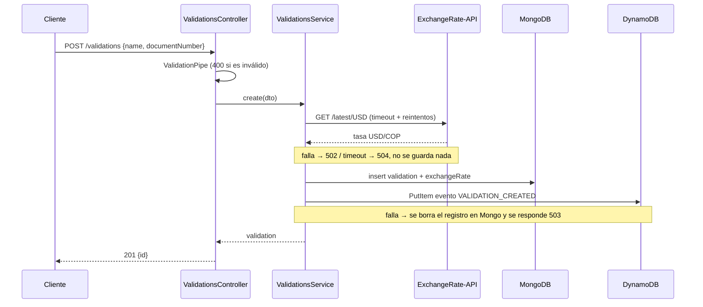

# Validations Service

Servicio en **NestJS** que registra validaciones de documentos. Cada registro se enriquece con la tasa de cambio **USD → COP** de una API pública, se guarda en **MongoDB** y deja un evento de auditoría en **DynamoDB Local**.

- `POST /validations` recibe un nombre y un número de documento, consulta la tasa de cambio, guarda el registro y responde con su `id`.
- `GET /validations/:id` devuelve el registro guardado.

## Contenido

- [Stack](#stack)
- [Arquitectura](#arquitectura)
- [Inicio rápido con Docker](#inicio-rápido-con-docker)
- [Desarrollo local](#desarrollo-local)
- [Variables de entorno](#variables-de-entorno)
- [API](#api)
- [Pruebas](#pruebas)
- [Auditoría en DynamoDB](#auditoría-en-dynamodb)
- [Decisiones de diseño](#decisiones-de-diseño)
- [CI/CD y flujo de trabajo](#cicd-y-flujo-de-trabajo)
- [Estructura del proyecto](#estructura-del-proyecto)
- [Uso de IA](#uso-de-ia)
- [Qué mejoraría con más tiempo](#qué-mejoraría-con-más-tiempo)

## Stack

| Capa | Tecnología |
|---|---|
| Runtime | Node.js 24 LTS, TypeScript, ESM |
| Framework | NestJS 12 |
| Validación | class-validator + class-transformer, Joi para variables de entorno |
| Persistencia | MongoDB 8 con Mongoose |
| Auditoría | DynamoDB Local con AWS SDK v3 (`lib-dynamodb`) |
| API externa | [ExchangeRate-API](https://www.exchangerate-api.com/docs/free) (acceso abierto, sin API key) con `@nestjs/axios` |
| Observabilidad | Logs JSON con pino (`nestjs-pino`), `x-request-id`, health checks con `@nestjs/terminus` |
| Documentación | OpenAPI / Swagger en `/docs` |
| Pruebas | Vitest, Supertest, mongodb-memory-server |
| Calidad | oxlint, Prettier, husky + commitlint (Conventional Commits) |
| Infraestructura | Docker multi-stage, Docker Compose, Jenkins |

## Arquitectura



Módulos:

- `validations`: controlador, servicio, DTO y schema de Mongo.
- `exchange-rate`: cliente HTTP de la API externa, con timeout, reintentos y conversión de errores.
- `audit`: cliente de DynamoDB y escritura de eventos.
- `health`: probes de liveness y readiness.
- `common`: filtro global de errores, configuración de logs y Swagger.
- `config`: carga tipada de configuración y validación del entorno con Joi.

## Inicio rápido con Docker

Requisito: Docker con Docker Compose v2.

```bash
cp .env.example .env
docker compose up -d --build
```

Esto levanta cuatro servicios:

- `app`: la API, en `http://localhost:3000`.
- `mongo`: MongoDB 8, en el puerto `27017`.
- `dynamodb`: DynamoDB Local, en el puerto `8000`.
- `dynamodb-init`: crea la tabla `validation-audit` si no existe y luego termina.

Para comprobar que todo funciona:

```bash
docker compose ps
curl http://localhost:3000/health/ready
```

La app debe aparecer como `healthy`. Swagger queda en **http://localhost:3000/docs**.

Para detener todo:

```bash
docker compose down
```

Si además quieres borrar los datos, agrega `-v`.

## Desarrollo local

Requisitos: Node.js 24 (`nvm use`, porque el repo incluye `.nvmrc`) y npm 11.

```bash
npm install
cp .env.example .env
docker compose up -d mongo dynamodb dynamodb-init
npm run start:dev
```

| Script | Descripción |
|---|---|
| `npm run start:dev` | API en modo watch, con logs legibles (`pino-pretty`) |
| `npm run build` | Compila a `dist/` |
| `npm run start:prod` | Ejecuta la versión compilada |
| `npm run lint` | oxlint con reglas que usan los tipos de TypeScript |
| `npm run format` | Prettier |
| `npm test` | Pruebas unitarias |
| `npm run test:e2e` | Pruebas end-to-end con MongoDB en memoria |
| `npm run test:cov` | Cobertura de las pruebas unitarias |

## Variables de entorno

Se validan al arrancar. Si falta una obligatoria o tiene un formato inválido, la aplicación no inicia y muestra todos los errores juntos.

| Variable | Obligatoria | Default | Descripción |
|---|---|---|---|
| `NODE_ENV` | No | `development` | `development`, `production` o `test` |
| `PORT` | No | `3000` | Puerto HTTP |
| `LOG_LEVEL` | No | `info` | `fatal`, `error`, `warn`, `info`, `debug`, `trace` o `silent` |
| `MONGO_URI` | Sí | | URI con esquema `mongodb://` o `mongodb+srv://` |
| `DYNAMODB_ENDPOINT` | No | | Endpoint de DynamoDB Local. Si se omite, se usa AWS |
| `DYNAMODB_REGION` | No | `us-east-1` | Región |
| `DYNAMODB_TABLE` | Sí | | Tabla de auditoría |
| `AWS_ACCESS_KEY_ID` / `AWS_SECRET_ACCESS_KEY` | No | | Las lee el SDK de AWS. En local se usa cualquier valor |
| `EXTERNAL_API_URL` | Sí | | URL base de ExchangeRate-API (`https://open.er-api.com/v6`) |
| `EXTERNAL_API_TIMEOUT_MS` | No | `3000` | Timeout por intento |
| `EXTERNAL_API_RETRIES` | No | `2` | Reintentos ante fallos pasajeros (0 a 5) |
| `EXCHANGE_BASE_CURRENCY` | No | `USD` | Moneda base (ISO 4217) |
| `EXCHANGE_TARGET_CURRENCY` | No | `COP` | Moneda destino (ISO 4217) |

## API

La documentación interactiva completa está en `/docs` (Swagger UI) y el JSON de OpenAPI en `/docs-json`.

### `POST /validations`

```bash
curl -X POST http://localhost:3000/validations \
  -H "Content-Type: application/json" \
  -d '{"name": "Juan Pérez", "documentNumber": "1020304050"}'
```

```json
{ "id": "6afe5ef34add1ee527b4ce7b" }
```

Reglas de validación:

- `name`: entre 2 y 100 caracteres. Solo letras (incluye tildes y ñ), espacios, apóstrofes, puntos y guiones. Los espacios sobrantes se normalizan.
- `documentNumber`: string de 5 a 15 dígitos. Se recibe como string para conservar los ceros a la izquierda; si llega como número, se rechaza.
- Si llega cualquier propiedad que no esté definida, la petición se rechaza.

| Código | Cuándo |
|---|---|
| `201` | Validación creada |
| `400` | Entrada inválida o propiedades no permitidas |
| `502` | La API de tasas falló, respondió con error o devolvió datos inválidos |
| `504` | La API de tasas no respondió a tiempo |
| `503` | No se pudo escribir la auditoría. El registro no se guarda |

### `GET /validations/:id`

```bash
curl http://localhost:3000/validations/6afe5ef34add1ee527b4ce7b
```

```json
{
  "id": "6afe5ef34add1ee527b4ce7b",
  "name": "Juan Pérez",
  "documentNumber": "1020304050",
  "exchangeRate": {
    "provider": "exchangerate-api.com",
    "baseCurrency": "USD",
    "targetCurrency": "COP",
    "rate": 3308.13231,
    "rateUpdatedAt": "2026-11-19T00:02:31.000Z",
    "fetchedAt": "2026-11-19T02:29:07.812Z"
  },
  "createdAt": "2026-11-19T02:29:07.822Z",
  "updatedAt": "2026-11-19T02:29:07.822Z"
}
```

| Código | Cuándo |
|---|---|
| `200` | Registro encontrado |
| `400` | El `id` no es un ObjectId válido |
| `404` | No existe |

### Formato de error

Todas las respuestas de error tienen la misma forma:

```json
{
  "statusCode": 400,
  "error": "Bad Request",
  "message": ["documentNumber must contain between 5 and 15 digits"],
  "path": "/validations",
  "timestamp": "2026-11-19T02:29:07.822Z"
}
```

Un error 500 nunca muestra detalles internos al cliente; el detalle completo queda en el log.

### Health checks

| Endpoint | Uso |
|---|---|
| `GET /health/live` | Liveness: el proceso responde. Lo usa el `HEALTHCHECK` del contenedor |
| `GET /health/ready` | Readiness: MongoDB y la tabla de DynamoDB responden. Si alguna falla, devuelve `503` con el detalle de cuál |

### Trazabilidad

Cada respuesta incluye el header `x-request-id`. Si el cliente lo envía, se reutiliza; si no, se genera un UUID. El mismo id aparece en los logs JSON de esa petición.

## Pruebas

```bash
npm test
npm run test:e2e
```

- **Unitarias (29):** validación del entorno, DTO, filtro de errores, cliente de tasas (reintentos, timeout, 4xx sin reintento, datos inválidos), auditoría (llaves y condición) y servicio (enriquecimiento, compensación cuando falla la auditoría).
- **E2E (11):** levantan la aplicación completa con MongoDB en memoria (`mongodb-memory-server`). La API externa y DynamoDB se reemplazan por dobles de prueba, para que las pruebas no dependan de la red. Cubren 201, 400, 404, 502 y 503, la normalización de datos, los health checks y la propagación del `x-request-id`.

La primera ejecución de las e2e descarga el binario de MongoDB (unos 100 MB).

## Auditoría en DynamoDB

Tabla `validation-audit`, con facturación bajo demanda (`PAY_PER_REQUEST`):

| Atributo | Ejemplo |
|---|---|
| `pk` (partition key) | `DOC#1020304050` |
| `sk` (sort key) | `2026-11-19T02:29:07.822Z#6afe5ef34add1ee527b4ce7b` |
| `eventType` | `VALIDATION_CREATED` |
| `validationId` | `6afe5ef34add1ee527b4ce7b` |
| `documentNumber` | `1020304050` |
| `occurredAt` | `2026-11-19T02:29:07.822Z` |

### Por qué estas llaves

- **PK por documento (`DOC#<documento>`).** La consulta natural de una auditoría es "qué pasó con este documento". Con esta PK, todo el historial de un documento sale con un solo `Query`, sin `Scan`.
- **SK por fecha (`<ISO-8601>#<validationId>`).** La fecha ISO se ordena correctamente como texto, así que los eventos salen en orden cronológico (`ScanIndexForward: false` los trae del más reciente al más antiguo). También permite filtrar por rango con `BETWEEN` o `begins_with(sk, '2026-11')` sin índices adicionales.
- **`validationId` al final de la SK.** Hace única cada llave aunque dos eventos del mismo documento ocurran en el mismo milisegundo, y une el evento con el registro de Mongo.
- **Prefijo `DOC#`.** Deja la tabla lista para guardar otros tipos de entidad en el futuro (diseño single-table) sin chocar con las llaves actuales.
- **Escritura condicional (`attribute_not_exists(pk)`).** Un evento nunca se sobrescribe.
- **Sin datos personales de más.** El evento guarda el documento y el id, pero no el nombre de la persona.

Para consultar el historial de un documento en local:

```bash
docker compose run --rm dynamodb-init "aws dynamodb query \
  --table-name validation-audit \
  --key-condition-expression 'pk = :pk' \
  --expression-attribute-values '{\":pk\":{\"S\":\"DOC#1020304050\"}}' \
  --endpoint-url http://dynamodb:8000"
```

## Decisiones de diseño

- **API externa.** La propuesta original era REST Countries, pero su v3.1 fue deprecada y la v5 exige API key. Elegí ExchangeRate-API porque su acceso abierto no requiere registro y la tasa USD/COP le agrega contexto real al registro.
- **Si el enriquecimiento falla, no se guarda nada.** Un registro sin enriquecer no cumple el contrato, y el cliente recibe un 502 o 504 claro con el que puede reintentar.
- **Reintentos solo ante fallos pasajeros.** Se reintenta ante timeouts, errores de red y 5xx, con espera exponencial (200 ms y luego 400 ms). Un 4xx, incluido el 429, no se reintenta porque repetirlo no lo arregla.
- **Consistencia entre Mongo y DynamoDB.** Son dos escrituras en sistemas distintos, sin una transacción común. Si la auditoría falla, se compensa borrando el registro de Mongo y se responde 503, para que nunca quede una validación sin su evento. La limitación (que la compensación también falle) está registrada en logs y explicada en [mejoras](#qué-mejoraría-con-más-tiempo).
- **Pipe y filtro globales registrados en `AppModule`** (`APP_PIPE` y `APP_FILTER`), no en `main.ts`, para que las pruebas e2e usen exactamente la misma configuración que producción.
- **Configuración que falla rápido.** El entorno se valida con Joi y cada módulo recibe su sección tipada con `registerAs` y `ConfigType`.
- **Imagen de producción mínima.** Build multi-stage, solo dependencias de producción, usuario sin privilegios (`node`) y `HEALTHCHECK`.

## CI/CD y flujo de trabajo

### Ramas

- `main`: versión entregable. Solo recibe cambios por Pull Request.
- `develop`: integración.
- `feat/*`, `fix/*`, `chore/*`, `ci/*`, `test/*`, `docs/*`: una rama por tarea, integrada a `develop` con un PR.

### Conventional Commits

husky y commitlint validan cada mensaje de commit (por ejemplo `feat(audit): ...` o `fix(config): ...`), y el hook `pre-commit` ejecuta el linter.

### Jenkins

El `Jenkinsfile` define un pipeline declarativo multibranch:

1. **CI** (en `node:24-bookworm`): `npm ci`, lint, pruebas unitarias, pruebas e2e y build. Publica los reportes JUnit.
2. **Docker Image** (solo en `main` y `develop`): construye la imagen etiquetada con el commit.
3. **Smoke Test** (solo en `main` y `develop`): levanta el stack completo con Compose, espera a que la app esté `healthy`, consulta `/health/ready` y destruye el stack.

Para correr Jenkins en local:

```bash
docker compose -f ci/jenkins/docker-compose.yml up -d --build
docker exec $(docker compose -f ci/jenkins/docker-compose.yml ps -q jenkins) cat /var/jenkins_home/secrets/initialAdminPassword
```

Después, en `http://localhost:8080`, crea un *Multibranch Pipeline* apuntando a este repositorio, con Script Path `Jenkinsfile`.

## Estructura del proyecto

```
src/
├── app.module.ts
├── main.ts
├── audit/                 Auditoría en DynamoDB
├── common/
│   ├── dto/               DTO de error para Swagger
│   ├── filters/           Filtro global de excepciones
│   ├── logger/            Configuración de pino
│   └── swagger.ts
├── config/                Configuración tipada y validación con Joi
├── exchange-rate/         Cliente de ExchangeRate-API
├── health/                Liveness y readiness
└── validations/           Endpoints, servicio, DTO y schema
test/
├── setup/                 MongoDB en memoria para las e2e
├── health.e2e-spec.ts
└── validations.e2e-spec.ts
ci/jenkins/                Jenkins local con Docker
Dockerfile
docker-compose.yml
docker-compose.ci.yml
Jenkinsfile
```

## Uso de IA

Usé un asistente de IA como par de programación durante todo el desarrollo. Le pedí ayuda para definir la arquitectura y el diseño de las llaves de DynamoDB, generar el esqueleto de cada módulo, las pruebas, el Dockerfile, Compose y el pipeline de Jenkins, y redactar la documentación. Revisé, ejecuté y probé cada propuesta antes de integrarla, rama por rama. Tuve que corregir varias cosas:

- La API que se propuso al inicio (REST Countries v3.1) había sido deprecada y su nueva versión exige API key. La cambié por ExchangeRate-API.
- Parte del código seguía convenciones de versiones anteriores de NestJS y no compilaba con la 12. Por ejemplo, `validationOptions: { abortEarly }` en `ConfigModule` ya no existe porque la validación ahora pasa por Standard Schema.
- La instalación fallaba con npm 10 por un error interno de npm; estandaricé el proyecto en Node 24 con npm 11.
- El health check de DynamoDB devolvía la descripción completa de la tabla, y el filtro global de errores ocultaba qué dependencia había fallado en `/health/ready`.
- En Compose, los nombres fijos de contenedor impedían que el stack de CI corriera junto al de desarrollo, y el contenedor heredaba `NODE_ENV=development`, lo que intentaba cargar `pino-pretty`, que no está en la imagen de producción.

## Qué mejoraría con más tiempo

- **Patrón Outbox** para garantizar la consistencia entre Mongo y DynamoDB: guardar el evento en Mongo dentro de la misma transacción y publicarlo a DynamoDB con un proceso aparte que reintente. Así se elimina la ventana en la que la compensación podría fallar.
- **Caché de la tasa de cambio** hasta la siguiente actualización que informa el proveedor (una vez al día), para reducir la latencia y el riesgo de un 429.
- **Idempotencia en el `POST`** con un header `Idempotency-Key`, para que los reintentos del cliente no creen duplicados.
- **Circuit breaker** sobre la API externa, para fallar rápido cuando está caída.
- **Endpoint de consulta de auditoría** (`GET /validations/audit/:documentNumber`) que aproveche el diseño de llaves.
- **Pruebas de integración contra DynamoDB Local** con Testcontainers.
- **Seguridad:** autenticación (API key o JWT), rate limiting con `@nestjs/throttler`, Helmet y CORS configurado.
- **Observabilidad:** trazas distribuidas y métricas con OpenTelemetry.
- **Despliegue real:** infraestructura como código (Terraform o CDK) hacia ECS o Lambda, con DynamoDB y DocumentDB/Atlas gestionados.

## Atribución

Rates By [Exchange Rate API](https://www.exchangerate-api.com).

## Licencia

MIT